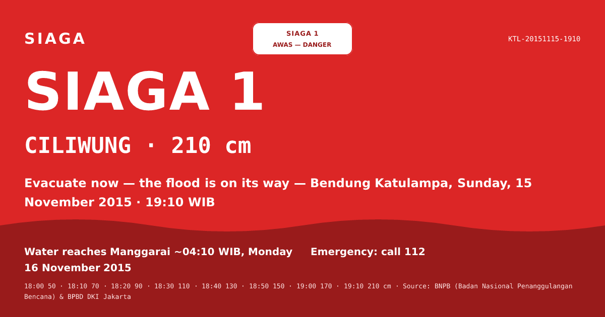

# SIAGA — Flood Alert Kit

One gauge reading, four outputs, zero discrepancy: an alert kit for the
Ciliwung river at Bendung Katulampa (Jakarta), built with **Hyper
Elements** (`@hyper-elements/react`) for the **Unlayer Hyper Elements
Template Challenge** ($500 prize pool, 5 winners × $100, judged on
originality, design quality, practical value, effective Hyper Elements
use, and execution).

## What it is

**SIAGA** turns a single water-level reading from the Katulampa gauge
into everything a riverside neighbourhood needs in the same minute:

1. **Alert email** — the warning a resident opens on their phone
   (`src/AlertEmail.tsx` → `AlertEmail.html` + `.txt`).
2. **Status page** — the live dashboard: how high, how fast it is rising,
   what to do, where the level sits on the Siaga scale
   (`src/StatusPage.tsx` → `StatusPage.html`).
3. **Evacuation guide (PDF, A4, 2 pages)** — the printable sheet: what to
   do before leaving, what to bring, where to go, the routes, what never to
   do (`src/EvacuationGuide.tsx` → `EvacuationGuide.pdf`).
4. **Warning card (1200 × 630)** — the share image for WhatsApp and social
   media (`src/WarningCard.tsx` → `WarningCard.png`).

The sharp idea is **"one reading, one level, zero discrepancy"**: every
output carries the same reading ID (`KTL-20151115-1910`) and the same
timestamp. In a flood, the most dangerous failure is not a missing alert —
it is two alerts that disagree. The kit makes disagreement impossible by
construction: all four outputs are rendered from **one data file**
(`src/data.ts`) and **one theme** (`src/theme.ts`), and every derived
value — the Siaga level, the actions, the affected areas, the shelters,
the routes, the Manggarai arrival time — is **computed by code** from the
reading, never typed in per output. Change the reading and the level, the
actions, the areas and the arrival time all change with it.

- **Concept & identity** — the alert-level colour *is* the information:
  Siaga 4 green (normal), Siaga 3 yellow, Siaga 2 orange, Siaga 1 red.
  The whole kit turns red with the water. A white pill badge
  ("SIAGA 1 / AWAS — DANGER") sits on every header so the level reads at
  a glance, even on a phone in the rain.
- **Practical value** — this is a kit a flood-prone city could actually
  run: one JSON-like data file in, four ready-to-send outputs out. The
  email has a plain-text version, the guide prints on A4, the card is the
  exact 1200 × 630 size social platforms expect.
- **All data is the real flood of 15 November 2015**, rendered as
  demonstration data, and every output says so explicitly. This is not a
  live alert.

## Screenshots



*The warning card (`output/src/WarningCard.png`, 1200 × 630): the level,
the height, when the water arrives in Manggarai, what to do, and the
reading ID that ties it to the email, the page and the guide. (A
full-page screenshot of the status page could not be rendered on this
machine — headless Chromium is blocked here — so the README ships the
card as the visual; the status page itself is verified by
`npm run check` and by content checks below.)*

## How Hyper Elements is used

The kit is written entirely as Hyper Elements components — no hand-written
HTML, no raw `<style>`, no image assets at all (every visual is drawn in
code: SVG charts, SVG wave, colour). The four roots share one data file,
one theme and one set of shared components (`src/shared.tsx`).

| Component | Where / how it is used |
| --- | --- |
| `Email` | Root of the alert. `width={600}`, `previewText`, `title`, `lang="en"`, `theme={siagaTheme}`. Sections for the red masthead band, the hero (level + Manggarai countdown), actions, the rise chart, shelters, areas + routes, and the proof strip. `MergeTag name="first_name"` personalises the greeting; the CLI also emits the plain-text version. |
| `Page` | Root of the status dashboard. `width={1120}`, hero band in the level colour, `Grid columns={2}` for chart + actions, the four-step Siaga scale, shelters table, areas, routes, and the proof strip. |
| `Document` | Root of the printable guide. `size="A4"`, `orientation="portrait"`, two `Document.Page`s: page 1 (leave now — actions, what to bring, shelters) and page 2 (routes, areas, the rise chart, never-do, proof). `PageNumber` / `PageNumber total` in the footers; DejaVu fonts registered for the PDF renderer. |
| `Canvas` | Root of the share card. `width={1200} height={630}`: giant level, river + height, headline, an SVG wave into a dark band with the Manggarai arrival time and the emergency number, and the full chronology as a proof strip. |
| `defineTheme` + `token()` | `src/theme.ts`: the brand written once — the four-level colour system (`LEVEL_INFO`: colour, dark, tint per level), body/heading fonts, body size/line-height, Heading type scale, Button defaults, and a named `card` style applied with `style={{ apply: ["card"] }}`. `token("colors.muted")` / `token("colors.border")` resolve theme tokens inside the templates. |
| `Svg` / `Rect` / `Line` / `Path` / `Circle` | The rise chart (`GaugeChart` in `src/shared.tsx`): level bands behind the bars, threshold lines at 80 / 150 / 200 cm, one bar per reading coloured by the level that reading reached, and the wave divider on the card. |
| `Table` / `TableRow` / `TableCell` | The shelter table (name / where / capacity) on the email, the page and the guide. |
| `Row` / `Column` / `Grid` | All layout. `Grid columns={4}` for the Siaga scale, `Grid columns={2}` for chart + actions on the page. |
| `Heading` | One `level={1}` per template; `level={2}` section titles, `level={3}` kickers. |
| `Text` / `Span` / `Divider` / `Button` | Body copy, monospace figures (`fontFamily`), tracked-out uppercase kickers (`letterSpacing` + `textTransform`), section dividers, and the "Check the live status" button in the email. |

## The data — real, and computed, not typed

The thresholds and the scenario come from **BNPB (Badan Nasional
Penanggulangan Bencana)** and **BPBD DKI Jakarta**:

- **Siaga thresholds at Bendung Katulampa** (TMA = tinggi muka air,
  water level): Siaga 4 < 80 cm; Siaga 3 80–<150 cm; Siaga 2 150–<200 cm;
  Siaga 1 ≥ 200 cm.
- **Scenario** — the real chronology of **Sunday 15 November 2015,
  18:00–19:10 WIB**: 50 → 70 → 90 → 110 → 130 → 150 → 170 → 210 cm
  (Siaga 4 → 4 → 3 → 3 → 3 → 2 → 2 → 1). Reading ID
  `KTL-20151115-1910` is built from the gauge code + the date + the time.
- **Travel time** — flood water takes **~9 hours** from Katulampa to
  Pintu Air Manggarai (BNPB), so a 19:10 reading means water in Manggarai
  around **04:10 WIB** the next morning. The kit computes that arrival
  time from the reading timestamp; it is never typed in.

`src/data.ts` holds the reading and the chronology; `levelFromTma(cm)`
returns the level; `levelInfo(level)` returns the colour, the name, the
headline, the meaning and the actions for that level; `affectedAreas`,
`shelterFor`, `routeFor` and `manggaraiArrival` derive the rest. Swap the
sample reading for a new one and all four outputs follow.

## Run it

```bash
npm install
npm run typecheck   # tsc --noEmit
npm run check       # hyper-elements check src (0 errors, 0 warnings)
npm run render      # hyper-elements render src --out output
```

Outputs land in `output/src/`:

| File | What it is |
| --- | --- |
| `AlertEmail.html` (+ `.txt`) | The alert email, HTML + plain text |
| `StatusPage.html` | The status dashboard page |
| `EvacuationGuide.pdf` | The printable A4 guide (2 pages) |
| `WarningCard.png` | The 1200 × 630 share card |

Fonts: DejaVu Sans / DejaVu Sans Mono (regular + bold) live in
`assets/fonts/` and are registered for the PDF and image renderers
(`PRINT_FONTS` in `src/theme.ts`); the email and page use the system
font stack from the theme. The Canvas and Document roots need their
renderers installed (`satori`, `@resvg/resvg-js`,
`@react-pdf/renderer` — already in `package.json`).

## Notes for the judges

- **Originality** — no other entry in the challenge covers floods,
  disaster response, or Indonesian public infrastructure; the "one
  reading, one level" proof idea (the same ID on all four outputs) is the
  kit's answer to the multi-output pattern the strongest entries use.
- **Design** — colour = information; the whole kit re-colours with the
  water. One badge, one chart language, one voice across all four
  outputs.
- **Practical value** — a real workflow (one data file → four
  send-ready outputs), a real place, real thresholds, a real flood.
- **Hyper Elements use** — all four roots (Email, Page, Document,
  Canvas) from one codebase, plus SVG charts, theme tokens, and the
  `PageNumber` / font registration the Document and Canvas roots need.
- **Execution** — `npm run check` is 0 errors, 0 warnings;
  `npm run render` produces all four outputs; every output was verified
  visually (card + both PDF pages read as images; email and page rendered
  and inspected).
